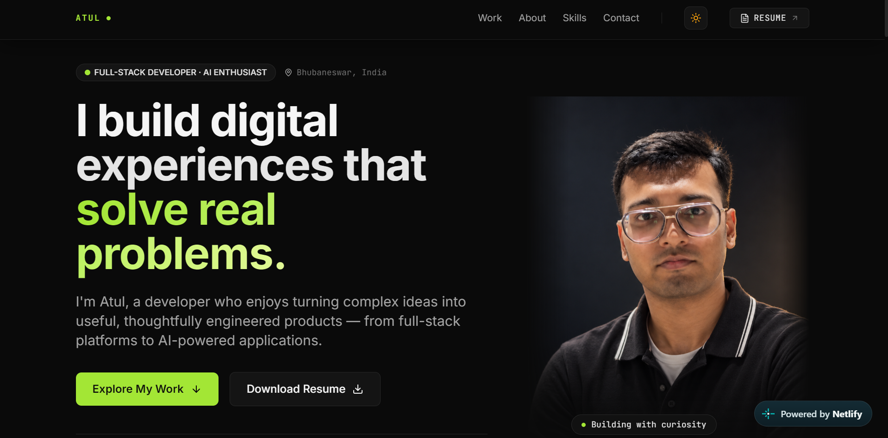
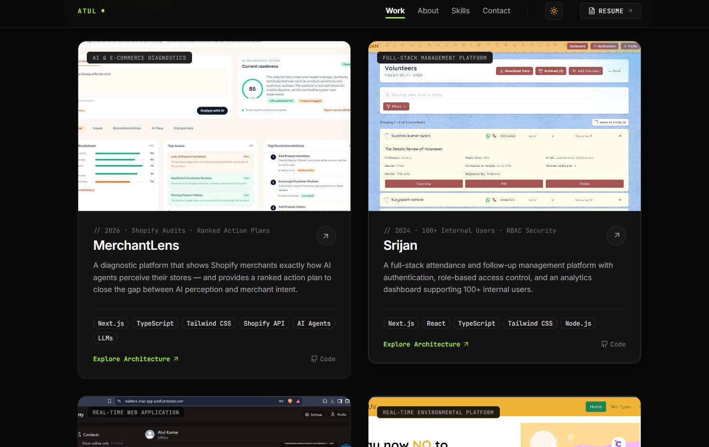
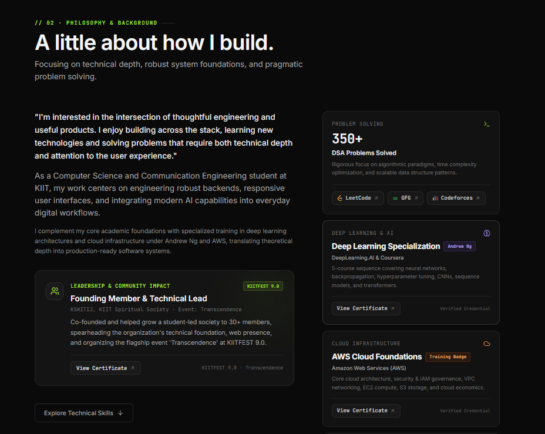

<div align="center">

# Atul Kumar — Developer Portfolio

**A modern, editorial developer portfolio built with React 19, Vite, Tailwind CSS, and Motion.**

Designed with an aesthetic focus on editorial typography, high-contrast dark and light modes, micro-interactions, and responsive design.

[](https://github.com/AtulKumar2004/portfolio)
[](https://react.dev/)
[](https://tailwindcss.com/)
[](https://vitejs.dev/)

---

## 📸 Website Preview

<!-- Paste your website screenshot URLs or relative file paths below -->

<p align="center">
  
</p>

<p align="center">
  
  
</p>

---

</div>

## 🌟 Highlights & Features

- **🌓 Dynamic Theme System**: Seamless toggle between dark and light modes with local storage persistence, anti-FOUC (Flash of Unstyled Content) initialization, and reactive meta `theme-color`.
- **💼 Interactive Project Showcase**: Filter projects by domain (`AI & Tools`, `Full-Stack`, `Real-Time`), launch live deployments directly via the circular `↗` action, or inspect comprehensive architectural modals with full tech stacks.
- **🧠 Verified Credentials & Coursework**: Direct links to verified certificates for **Deep Learning Specialization (Andrew Ng)**, **AWS Cloud Foundations Training Badge**, **Supervised Machine Learning**, and **KIITFEST 9.0 Transcendence**.
- **💻 Problem Solving Coordinates**: Integrated metrics and links for **350+ DSA problems** across **LeetCode**, **GeeksforGeeks (GFG)**, and **Codeforces**.
- **⚡ Performance & Motion**: Smooth scroll triggers and micro-interactions powered by `motion/react` with zero layout shifts and lightweight asset bundles.
- **📱 Fully Responsive**: Custom mobile navigation drawer, fluid typography, and adaptive portrait masks.
- **☁️ Zero-Config Netlify Deployment**: Configured with `netlify.toml` and SPA `_redirects` for continuous delivery.

---

## 🛠️ Tech Stack

| Layer | Technologies |
| :--- | :--- |
| **Frontend Framework** | [React 19](https://react.dev/) with [Vite](https://vitejs.dev/) |
| **Styling & Design System** | [Tailwind CSS v3](https://tailwindcss.com/) with custom typography & CSS tokens |
| **Animations & Transitions** | [Motion (Framer Motion)](https://motion.dev/) |
| **Icons** | [Lucide React](https://lucide.dev/) & Custom SVG Brand Monograms |
| **Hosting & CI/CD** | [Netlify](https://www.netlify.com/) (automatic build & SPA redirects) |

---

## 📁 Repository Structure

```text
portfolio/
├── netlify.toml                # Root Netlify build & redirect rules
├── package.json                # Workspace script convenience runner
├── .gitignore                  # Git ignore rules for dependencies & outputs
└── my-portfolio/               # Vite React application
    ├── public/
    │   ├── _redirects          # Netlify SPA routing fallback
    │   ├── favicon.svg         # SVG favicon
    │   ├── resume.pdf          # Downloadable PDF resume
    │   └── images/
    │       ├── profile.jpg     # Hero portrait photograph
    │       └── projects/       # Production project thumbnail assets
    ├── src/
    │   ├── components/
    │   │   ├── home/           # Hero, SelectedWork, AboutPreview, TechStack, ContactCTA
    │   │   ├── layout/         # Navbar, Footer, Container
    │   │   └── ui/             # Buttons, Badges, Icons, Reveal animations
    │   ├── context/            # ThemeContext (dark/light state engine)
    │   ├── data/               # profile.js & projects.js data configuration
    │   ├── App.jsx             # Root layout composer
    │   ├── index.css           # Tailwind base styles, scrollbars & grid overlays
    │   └── main.jsx            # React 19 entry point
    ├── index.html              # HTML shell with meta tags & anti-FOUC script
    ├── tailwind.config.js      # Custom theme extensions & colors
    └── vite.config.js          # Vite configuration
```

---

## 🚀 Getting Started Locally

### Prerequisites

- [Node.js](https://nodejs.org/) (version 18.0 or higher recommended)
- [npm](https://www.npmjs.com/) (version 9.0 or higher)

### Installation

1. **Clone the repository:**
   ```bash
   git clone https://github.com/AtulKumar2004/portfolio.git
   cd portfolio
   ```

2. **Navigate into the project and install dependencies:**
   ```bash
   cd my-portfolio
   npm install
   ```

3. **Start the local development server:**
   ```bash
   npm run dev
   ```
   Open [http://localhost:5173/](http://localhost:5173/) to view the portfolio in your browser.

4. **Build for production:**
   ```bash
   npm run build
   ```
   The optimized production bundle will be generated in `my-portfolio/dist/`.

---

## ☁️ Deployment on Netlify

This repository is pre-configured with `netlify.toml` for zero-configuration deployments:

1. Import your GitHub repository into [Netlify](https://app.netlify.com/).
2. Netlify will detect:
   - **Base directory**: `my-portfolio`
   - **Build command**: `npm run build`
   - **Publish directory**: `my-portfolio/dist`
3. Click **Deploy**. Any future commits to `main` will trigger automatic preview and production deployments.

---

## 📬 Connect & Collaborate

- **Email**: [akdeoghar16@gmail.com](mailto:akdeoghar16@gmail.com)
- **GitHub**: [@AtulKumar2004](https://github.com/AtulKumar2004)
- **LinkedIn**: [Atul Kumar](https://linkedin.com/in/atulkumar9024)
- **LeetCode**: [@akdeoghar16](https://leetcode.com/u/akdeoghar16/)
- **GeeksforGeeks**: [@akdeogpwhr](https://www.geeksforgeeks.org/profile/akdeogpwhr)
- **Codeforces**: [@atulkrp](https://codeforces.com/profile/atulkrp)

---

<div align="center">
  <sub>Crafted with care by Atul Kumar · © 2026 All Rights Reserved</sub>
</div>
